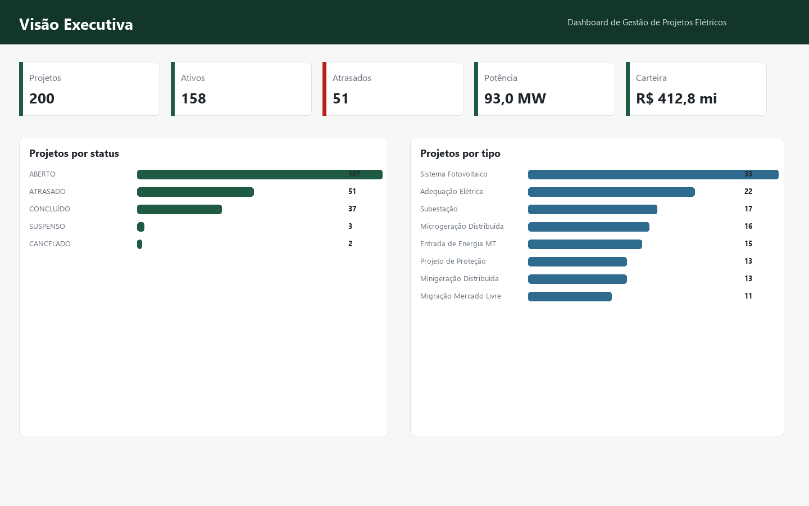
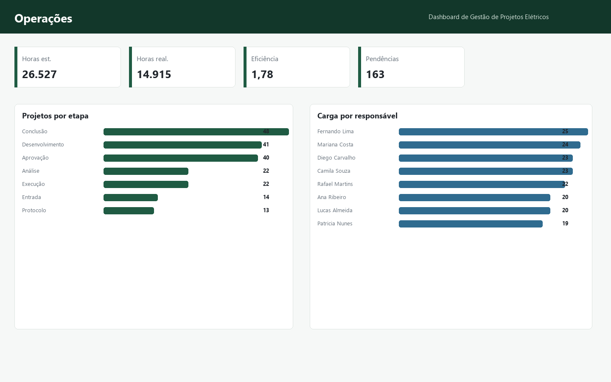
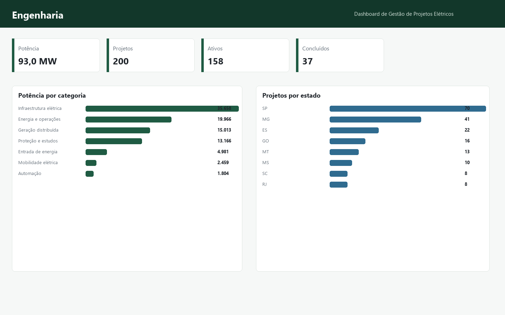
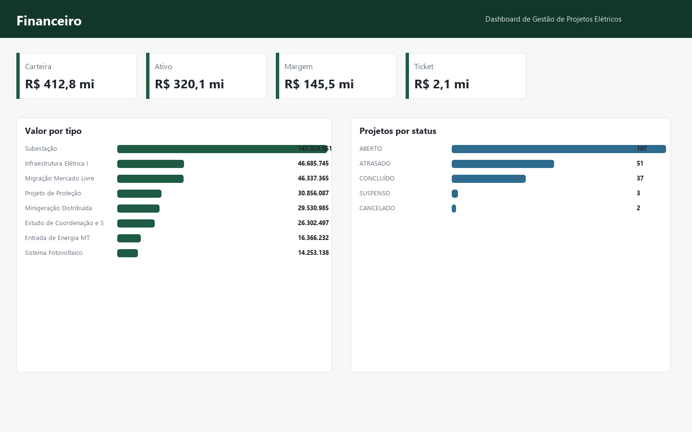
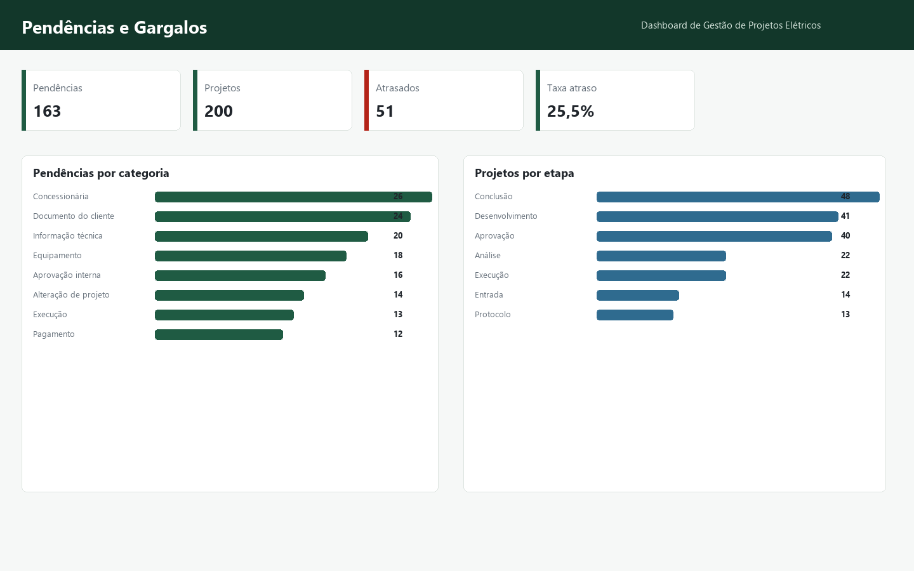
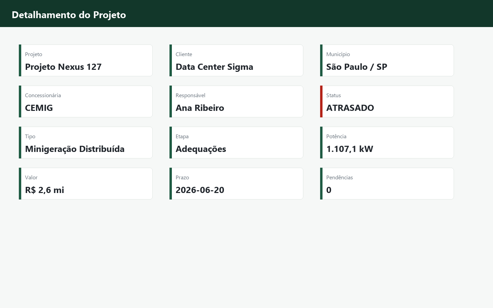

# Dashboard de Gestão de Projetos Elétricos

Projeto completo de portfólio em Business Intelligence para gestão de projetos de engenharia elétrica, com dados sintéticos, Excel profissional, documentação Power BI, medidas DAX, mockups e demo web estática.

Demo online: [https://renovera1.github.io/electrical-project-management-dashboard/](https://renovera1.github.io/electrical-project-management-dashboard/)

## Prévia do Dashboard









## Indicadores Principais

| Indicador | Valor |
| --- | --- |
| Total de projetos | 200 |
| Projetos ativos | 158 |
| Projetos atrasados | 51 |
| Projetos concluídos | 37 |
| Potência total | 93,0 MW |
| Valor da carteira | R$ 412,8 mi |
| Pendências | 163 |
| Conclusão no prazo | 54,1% |

## Entregas

- `data/`: CSVs em UTF-8 com dados sintéticos.
- `dashboard_data.xlsx`: planilha com dashboard, tabelas, filtros, congelamento de painéis, formatação e gráficos.
- `powerbi/`: DAX, Power Query, modelo, tema e guia de montagem.
- `web/`: dashboard estático com sete páginas e filtros funcionais.
- `docs/`: dicionários, resumo executivo, insights, currículo e case de entrevista.
- `linkedin/`: textos e imagens para publicação no LinkedIn.
- `outputs/resumo_portfolio.json`: fonte única dos KPIs finais.

## Como Atualizar

```bash
python scripts/finalizar_projeto.py
```

No Windows, execute `ATUALIZAR_TUDO.bat`. Para abrir a demo local, execute `INICIAR_DASHBOARD.bat`.

## Power BI

O arquivo PBIX não é simulado. Para montar o relatório oficial, siga `powerbi/GUIA_MONTAGEM_POWER_BI.md`.

## Privacidade

Todos os dados são sintéticos e fictícios. Não há clientes, protocolos, documentos ou informações confidenciais reais.

## Autor

Lucas Almeida
