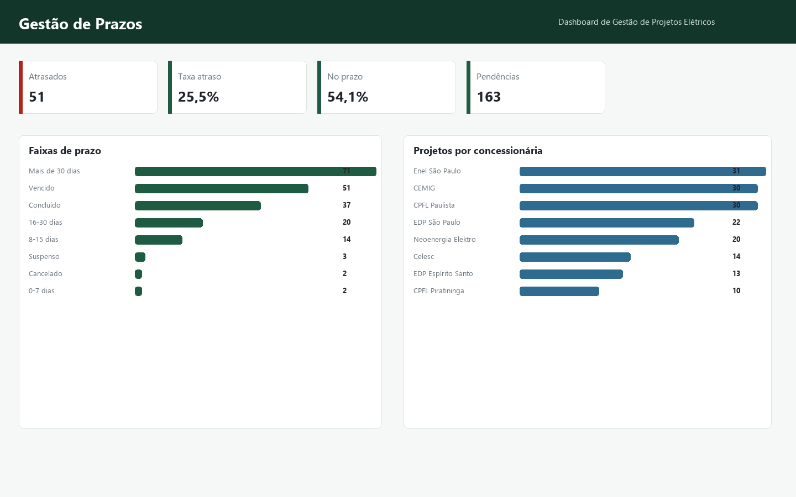

# Dashboard de Gestão de Projetos Elétricos & Homologação
### *Electrical Engineering Project Management Dashboard*

[](https://luscaarmstrong1.github.io/electrical-project-management-dashboard/)
[](https://lucas-santos-portfolio-zeta.vercel.app/)
[](https://www.linkedin.com/in/lucasssantos1/)
[](https://github.com/luscaarmstrong1/electrical-project-management-dashboard)

> **Camada 07 • Ecossistema de Engenharia, Energia, Dados & Automação**
> Controle executivo de carteira de projetos elétricos e fotovoltaicos (GD/MT): prazos regulatórios ANEEL/PRODIST, pareceres de acesso, ARTs, margens e gargalos.

---

## Acesse o Simulador Interativo e Demonstração Online

- **Simulador Paramétrico Web (GitHub Pages):** [https://luscaarmstrong1.github.io/electrical-project-management-dashboard/](https://luscaarmstrong1.github.io/electrical-project-management-dashboard/)
- **Vitrine no Portfólio Principal:** [https://lucas-santos-portfolio-zeta.vercel.app/#arquitetura](https://lucas-santos-portfolio-zeta.vercel.app/#arquitetura)

---

## Visão Geral e Problema de Engenharia

Plataforma de Business Intelligence e gestão operacional de carteiras de projetos elétricos (GD, Média Tensão e Subestações): controle de prazos PRODIST, emissão de ART, pareceres de acesso, gargalos e KPIs financeiros.

### Indicadores-Chave do Projeto (Caso-Base)

| Indicador Técnico | Resultado / Escopo | Detalhamento de Engenharia |
| :--- | :--- | :--- |
| **Carteira Monitorada** | `7Dimensões BI` | Executiva, Prazos, Engenharia e Finanças |
| **Fluxo Regulatório** | `PRODIST Mód. 3` | Solicitação, Parecer, Obras e Vistoria |
| **Controle de Riscos** | `SLA & Gargalos` | Triagem de reprovações e inversão de fluxo |
| **Rastreabilidade** | `100% Auditável` | ART, documentação técnica e margem |

---

## Arquitetura do Sistema e Fluxo de Modelagem

1. **Etapa 01:** Estruturação da Base de Operações (Cadastro de projetos BT/MT, concessionárias, prazos regulatórios e ARTs)
2. **Etapa 02:** Indicadores de Engenharia & Regulação (Lead time de parecer de acesso, taxa de retrabalho e pendências de campo)
3. **Etapa 03:** Modelagem Financeira por Projeto (Orçado vs. Realizado, custo de hora-técnica e rentabilidade por porte)
4. **Etapa 04:** Painel Web Interativo & Power BI (7 visões gerenciais com filtros dinâmicos por status, concessionária e engenheiro)

---

## Fundamentação Física, Matemática e Regulatória

### 1. Índice de Cumprimento de Prazo (On-Time Delivery)
```text
OTD (%) = (Projetos_Homologados_Dentro_SLA / Total_Projetos_Concluídos) × 100
```

### 2. Potência Total em Carteira (MWp)
```text
P_Carteira = Σ P_i(kWp) / 1000  [Segmentada por BT, MT e Subestação]
```

### 3. Margem Operacional de Engenharia
```text
Margem (%) = [(Receita_Projetos - Custo_HH_Engenharia - Taxas_ART_CREA) / Receita_Projetos] × 100
```

---

## Painéis Analíticos e Evidências Visuais

### Visão Executiva da Carteira de Engenharia


### Controle de Prazos e SLA de Homologação


### Produtividade Técnica, ARTs e Revisões


### Funil Operacional e Etapas de Conexão


---

## Como Executar Localmente

```bash
# 1. Clone o repositório
git clone https://github.com/luscaarmstrong1/electrical-project-management-dashboard.git
cd electrical-project-management-dashboard

# 2. Instale as dependências e execute a suíte analítica
pip install -r requirements.txt
python scripts/generate_data.py
python scripts/build_project_assets.py
```

> **Nota Técnica:** Este projeto utiliza modelagem determinística auditável e séries sintéticas estruturadas para demonstração de arquitetura de engenharia elétrica, ciência de dados e tomada de decisão técnico-econômica. Não substitui projeto executivo, parecer de acesso da concessionária ou emissão de ART específica de campo.

---

## Autor e Responsável Técnico

**Lucas Silva Santos**
*Engenheiro Eletricista & Gerente de Projetos*
Energia • Dados • Inteligência Artificial • Automação • São João da Boa Vista, SP • Itajubá, MG

- **Portfólio:** [https://lucas-santos-portfolio-zeta.vercel.app/](https://lucas-santos-portfolio-zeta.vercel.app/)
- **LinkedIn:** [linkedin.com/in/lucasssantos1](https://www.linkedin.com/in/lucasssantos1/)
- **GitHub:** [@luscaarmstrong1](https://github.com/luscaarmstrong1)
