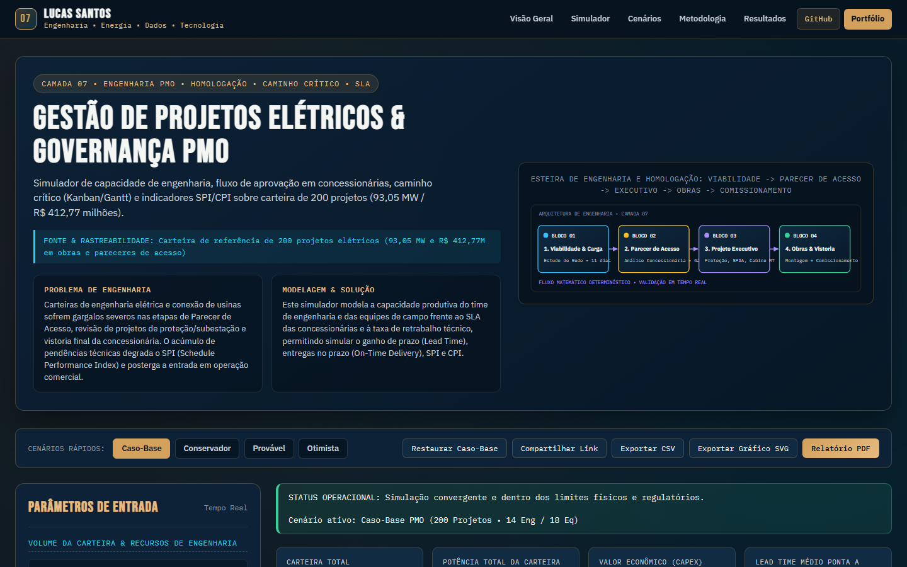

# Gestão de Projetos Elétricos & Governança PMO

> **Camada 07 do Ecossistema de Engenharia Interativa V3 • Engenharia PMO • Homologação • Caminho Crítico • SLA**  
> Simulador de capacidade de engenharia, fluxo de aprovação em concessionárias, caminho crítico (Kanban/Gantt) e indicadores SPI/CPI sobre carteira de 200 projetos (93,05 MW / R$ 412,77 milhões).

[](https://luscaarmstrong1.github.io/electrical-project-management-dashboard/)
[](https://github.com/luscaarmstrong1/electrical-project-management-dashboard)
[](https://luscaarmstrong1.github.io/electrical-project-management-dashboard/)
[](https://lucassantos.eng.br/#arquitetura)
[](https://github.com/luscaarmstrong1/electrical-project-management-dashboard)

---

## 1. Resumo Executivo

Este repositório integra o ecossistema de **Engenharia Interativa V3** de **Lucas Santos**, combinando modelagem física e técnico-econômica em Python com um **Simulador Web Interativo publicado no GitHub Pages** ([https://luscaarmstrong1.github.io/electrical-project-management-dashboard/](https://luscaarmstrong1.github.io/electrical-project-management-dashboard/)).

- **Rastreabilidade dos Dados e Modelo:** Carteira de referência de 200 projetos elétricos (93,05 MW e R$ 412,77M em obras e pareceres de acesso).
- **Aplicação Web Autônoma:** Executa integralmente no navegador sem dependências externas frágeis, com validação de fronteira, comparador multicenário e exportação técnica (CSV, SVG e Relatório PDF).

---

## 2. Problema de Engenharia Abordado

Carteiras de engenharia elétrica e conexão de usinas sofrem gargalos severos nas etapas de Parecer de Acesso, revisão de projetos de proteção/subestação e vistoria final da concessionária. O acúmulo de pendências técnicas degrada o SPI (Schedule Performance Index) e posterga a entrada em operação comercial.

---

## 3. Solução Proposta

Este simulador modela a capacidade produtiva do time de engenharia e das equipes de campo frente ao SLA das concessionárias e à taxa de retrabalho técnico, permitindo simular o ganho de prazo (Lead Time), entregas no prazo (On-Time Delivery), SPI e CPI.

---

## 4. Funcionalidades Principais da Aplicação Interativa (V3)

1. **Painel Paramétrico Sincronizado (Slider + Input Numérico):** Controles duplos bidirecionais agrupados por domínio físico, operacional e econômico, com validação contra valores inválidos (`NaN`, `Infinity` ou fora de faixa).
2. **Motor Matemático Determinístico Auditado:** Recálculo instantâneo de todos os indicadores-chave (KPIs), balanços energéticos e séries temporais/financeiras.
3. **Múltiplas Visualizações Gráficas em Alta Nitidez (SVG):** Abas dedicadas com gráficos vetoriais responsivos e tooltips informativos.
4. **Comparador Multicenário Lado a Lado:** Comparação simultânea entre **Caso-Base**, **Conservador**, **Provável**, **Otimista** e a **Simulação Atual** do usuário.
5. **Diagnóstico Técnico Automatizado:** Geração dinâmica de alertas operacionais e recomendações de engenharia conforme os parâmetros configurados.
6. **Exportação e Compartilhamento:**
   - **Compartilhar Link:** Codifica todos os parâmetros na URL (`?param=valor`) para reprodutibilidade exata.
   - **Exportar CSV:** Download imediato da tabela de memória de cálculo.
   - **Exportar Gráfico SVG:** Download vetorial do gráfico ativo.
   - **Relatório PDF:** Folha de estilo dedicada para impressão técnica.

---

## 5. Demonstração Visual (Captura Real V3)



- **Acesse o Simulador Interativo:** [https://luscaarmstrong1.github.io/electrical-project-management-dashboard/](https://luscaarmstrong1.github.io/electrical-project-management-dashboard/)
- **Voltar à Seção #arquitetura no Portfólio:** [https://lucassantos.eng.br/#arquitetura](https://lucassantos.eng.br/#arquitetura)

---

## 6. Arquitetura Técnica e Fluxo de Dados

```text
[Parâmetros do Usuário / Presets de Cenário]
                 │
                 ▼
[Validação de Fronteira & Normalização Física]
                 │
                 ▼
[Motor Matemático Determinístico (Python & JS Engine V3)]
                 │
     ┌───────────┼───────────┐
     ▼           ▼           ▼
[KPI Cards] [Gráficos SVG] [Matriz Multicenário & Exportação CSV/PDF]
```

---

## 7. Metodologia e Equações Governantes

### 9.1. Lead Time de Caminho Crítico com Retrabalho e Capacidade

```text
T_total = Σ_k [ T_base,k / (Cap_efetiva)^α ] + Penalidade_SLA + Taxa_Pendência * T_reanalise
```

Modela o impacto não-linear da saturação das equipes de projeto/obra e dos ciclos extras de reprovação em concessionárias.

### 9.2. Indicadores de Valor Agregado (SPI e CPI)

```text
SPI = EV / PV ≈ Prazo_Meta / Lead_Time_Real   |   CPI = EV / AC
```

Métricas clássicas de governança PMO (PMBOK) para monitoramento de desempenho de cronograma e orçamento.

---

## 8. Premissas e Limitações do Modelo

- **Escopo Analítico:** Os resultados constituem estudos preliminares de engenharia e viabilidade técnico-econômica. Projetos executivos requerem medições locais de campanha, estudos de curto-circuito/coordenação de proteção e parecer formal da concessionária ou ONS/CCEE.
- **Conservação Física:** Nenhuma eficiência excede 100%, nenhum despacho de bateria viola `[SOC_min, SOC_max]` e todas as séries respeitam limites físicos estritos.

---

## 9. Parâmetros de Entrada e Faixas Aceitas

| Parâmetro | Unidade | Faixa Permitida | Valor Padrão | Descrição Técnica |
|---|---|---|---|---|
| **Projetos na Carteira Ativa** (`totalProjetos`) | projetos | [20 a 600] | `200` | Total de empreendimentos elétricos gerenciados pelo PMO. |
| **Capacidade de Engenharia (Projetistas)** (`engEquipe`) | engenheiros | [4 a 45] | `14` | Engenheiros eletricistas dedicados a projetos e estudos de proteção. |
| **Equipes de Montagem e Comissionamento** (`equipesCampo`) | equipes | [4 a 60] | `18` | Frentes de obra para execução eletromecânica e testes. |
| **Aderência das Concessionárias ao SLA** (`slaConcessionariaPct`) | % | [40 a 100] | `85` | Percentual de pareceres e vistorias emitidos dentro do prazo regulatório. |
| **Taxa de Reanálise / Pendência Técnica** (`taxaPendenciaPct`) | % | [2 a 50] | `18` | Proporção de projetos que sofrem reprovação documental ou técnica na 1ª submissão. |
| **Meta Corporativa de Lead Time (SLA)** (`metaPrazoDias`) | dias | [45 a 180] | `90` | Prazo alvo ponta a ponta desde a abertura até a ligação. |
| **Reserva de Contingência Orçamentária** (`contingenciaPct`) | % | [0 a 25] | `8` | Margem financeira para absorver variações de materiais e escopo. |

---

## 10. Indicadores de Saída (KPIs Explicados)

| Indicador (KPI) | Unidade | Interpretação de Engenharia |
|---|---|---|
| **Carteira Total** (`totalProjetos`) | projetos | Empreendimentos sob gestão do PMO |
| **Potência Total da Carteira** (`portfolioMw`) | MW | Capacidade elétrica agregada |
| **Valor Econômico (CAPEX)** (`portfolioValueM`) | R$ mi | Volume financeiro gerenciado |
| **Lead Time Médio Ponta a Ponta** (`avgLeadTimeDays`) | dias | Ciclo completo até comissionamento |
| **Entregas no Prazo (On-Time)** (`onTimePct`) | % | Projetos concluídos dentro da meta SLA |
| **Projetos com Atraso Crítico** (`delayedProjects`) | projetos | Obras impactadas por fila ou pendência |
| **SPI (Índice de Prazo)** (`spi`) | adim. | Schedule Performance Index (meta >= 1,00) |
| **CPI (Índice de Custo)** (`cpi`) | adim. | Cost Performance Index (meta >= 1,00) |

---

## 11. Estrutura de Diretórios do Repositório

```text
electrical-project-management-dashboard/
├── docs/                       # Aplicação Web Interativa V3 (GitHub Pages)
│   ├── index.html              # Interface completa com esquemático SVG e seções técnicas
│   ├── simulator.css           # Design System Dark Technical Navy + Copper Gold V3
│   ├── simulator.js            # Motor matemático JS auditado + renderizador gráfico SVG
│   └── assets/
│       └── v3-preview.png      # Captura real da interface V3 em 1440x900
├── src/                        # Módulos Python de engenharia, simulação e pipeline de dados
├── data/                       # Datasets de referência, séries curadas e saídas analíticas
├── tests/                      # Testes automatizados de consistência matemática
└── README.md                   # Documentação técnica completa (18 seções)
```

---

## 12. Como Executar Localmente

### 12.1. Simulador Web Interativo (Zero Dependências)

```bash
git clone https://github.com/luscaarmstrong1/electrical-project-management-dashboard.git
cd electrical-project-management-dashboard
npx serve docs
```

Ou abra `docs/index.html` em qualquer servidor HTTP estático local.

### 12.2. Pipeline Analítico em Python

```bash
python -m venv .venv
.venv\Scripts\activate
pip install -r requirements.txt
pytest
```

---

## 13. Como Executar os Testes Automatizados

- **Validação Matemática e de Fronteira:** Verifica ausência de `NaN`/`Infinity`, conservação de energia, monotonia econômica e casos analíticos de referência.
- **Validação E2E e Responsiva (Playwright):** Verifica 0 erros de console, atualização dinâmica de KPIs e gráficos e 0px de overflow horizontal em `320x568`, `390x844`, `768x1024`, `1024x768` e `1440x900`.

---

## 14. Casos de Uso Práticos

1. **Estudos Preliminares de Engenharia e Propostas Técnicas:** Avaliação rápida de sensibilidade junto a clientes industriais e comerciais.
2. **Auditoria de Premissas Técnico-Econômicas:** Comparação transparente entre cenários conservadores, prováveis e otimistas.
3. **Demonstração de Competência Multidisciplinar:** Integração real entre engenharia elétrica, regulação, ciência de dados e desenvolvimento full-stack.

---

## 15. Próximas Evoluções Técnicas

- Integração via API REST com séries meteorológicas INMET/NSRDB e dados horários CCEE/ONS em tempo real.
- Otimização estocástica via Monte Carlo para quantificação de VaR (Value at Risk) energético.

---

## 16. Autor e Contato Profissional

**Lucas Santos**  
*Engenheiro Eletricista • Sistemas de Potência, Energias Renováveis, Dados & Software*

- **Portfólio Principal:** [https://lucassantos.eng.br](https://lucassantos.eng.br)
- **Seção de Engenharia Interativa:** [https://lucassantos.eng.br/#arquitetura](https://lucassantos.eng.br/#arquitetura)
- **GitHub:** [https://github.com/luscaarmstrong1](https://github.com/luscaarmstrong1)
